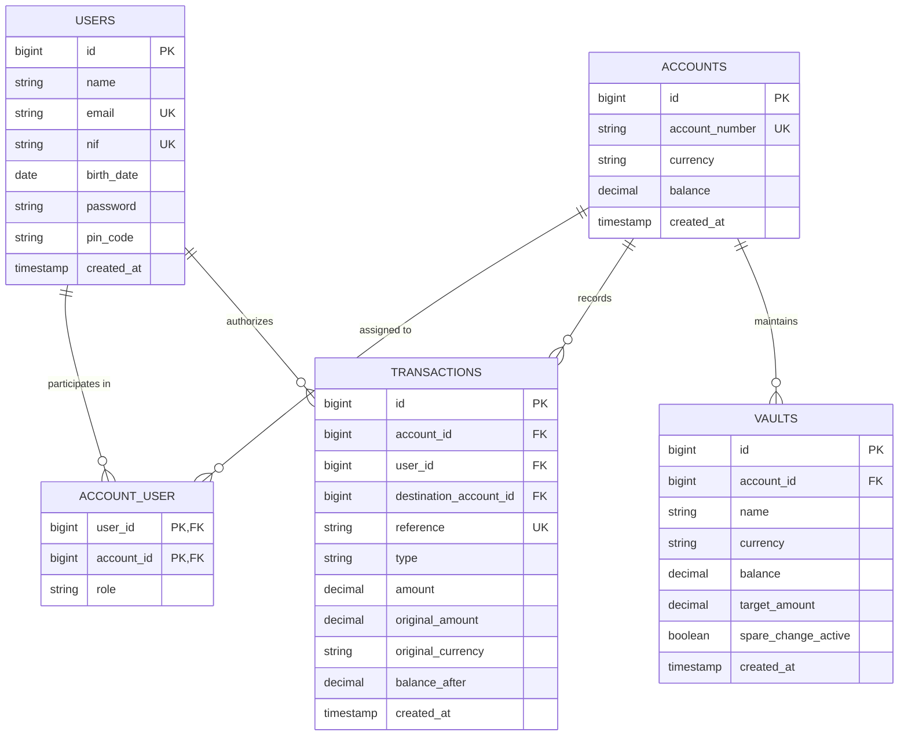

# 🏦 Core Banking API

<p align="center">
  
  
  
  
  
</p>

> A RESTful API simulating the backend of a digital bank, built with **PHP 8.3**, **Laravel 11**, and **Laravel Sanctum**.

> [!NOTE]
> Developed as an academic capstone project (Evaluation: **20/20**), this API demonstrates core financial transactions: account management with PT50 IBANs, atomic cross-account transfers, pessimistic concurrency locking, 4-digit PIN verification for sensitive actions, and micro-savings vaults.

---

## ✨ Features

* **Atomic Transactions & Concurrency Safety:** Balance-changing operations (transfers, deposits, withdrawals) run inside database transactions protected by row-level pessimistic locking (`lockForUpdate()`) to prevent race conditions. Accounts in cross-transfers are locked in deterministic ID order to avoid deadlocks.
* **Two-Factor Action Verification:** Session authentication via Sanctum bearer tokens; sensitive balance-affecting operations (`withdraw`, `transfer`, `payment`) require authorization with a hashed **4-digit PIN**.
* **Multi-Currency Support & Exchange Rates:** Real-time currency conversions using European Central Bank reference rates (via the Frankfurter API), cached with a 1-hour TTL to reduce external latency and avoid rate limits.
* **Micro-Savings Vaults & Spare Change:** Create dedicated savings goals linked to accounts. When enabled, card payments round up transactions to the next whole unit and route the spare change directly into an active vault.
* **French Loan Amortization Simulator:** Computes monthly installments and month-by-month schedules using the French constant-annuity formula.
* **Automated Test Suite:** Feature and unit tests in PHPUnit covering registration, account limits, transfers, rollback integrity, and calculation edge cases.

---

## 🗂️ Database Schema (ERD)



---

## 📑 API Endpoints Reference

| Method | Endpoint | Description | Auth Level |
| :--- | :--- | :--- | :--- |
| `POST` | `/api/register` | Register new customer profile with PIN | Public |
| `POST` | `/api/login` | Authenticate and issue Bearer Token | Public |
| `GET` | `/api/accounts/my-accounts` | List accounts belonging to user | 🔐 Sanctum |
| `POST` | `/api/accounts` | Open account with PT50 IBAN | 🔐 Sanctum |
| `GET` | `/api/accounts/{id}/balance` | Check real-time balance | 🔐 Sanctum |
| `POST` | `/api/accounts/{id}/deposit` | Deposit funds (with currency conversion if needed) | 🔐 Sanctum |
| `POST` | `/api/accounts/{id}/withdraw` | Withdraw funds | 🔐 Sanctum + PIN |
| `POST` | `/api/transfers` | Cross-account transfer | 🔐 Sanctum + PIN |
| `POST` | `/api/accounts/{id}/payment` | Card payment with optional spare-change rounding | 🔐 Sanctum + PIN |
| `GET` | `/api/accounts/{id}/transactions` | Paginated transaction history | 🔐 Sanctum |
| `GET` | `/api/accounts/{id}/statement` | Filtered account statement by date and type | 🔐 Sanctum |
| `GET` | `/api/vaults/my-vaults` | List all savings vaults | 🔐 Sanctum |
| `POST` | `/api/accounts/{accountId}/vaults` | Create new savings vault | 🔐 Sanctum |
| `POST` | `/api/vaults/{id}/deposit` | Move funds from account into vault | 🔐 Sanctum |
| `POST` | `/api/vaults/{id}/withdraw` | Move funds from vault back to account | 🔐 Sanctum |
| `PATCH` | `/api/vaults/{id}/spare-change` | Toggle spare-change rounding | 🔐 Sanctum |
| `POST` | `/api/loans/simulate` | Calculate loan amortization schedule | 🔐 Sanctum |

---

## 🚀 Getting Started

### Prerequisites
* **PHP 8.3+** with SQLite extension
* **Composer**

### 1. Clone the repository
```bash
git clone https://github.com/Afonsojlc/core-banking-api.git
cd core-banking-api
```

### 2. Install dependencies
```bash
composer install
```

### 3. Environment configuration
```bash
cp .env.example .env
php artisan key:generate
```
*(Runs on SQLite by default — no external database setup required).*

### 4. Run migrations & demo seeders
```bash
php artisan migrate --seed
```

Demo seed accounts:
* **Primary Demo User:** `demo@bank.com` | Password: `password123` | PIN: `1234`
  * EUR Account balance: €5,000.00
  * USD Account balance: $2,500.00
  * Active Vault: "Emergency Fund" (€450.00)
* **Secondary User:** `jane@bank.com` | Password: `password123` | PIN: `1234`

### 5. Start the server
```bash
php artisan serve
```
The API is available at `http://127.0.0.1:8000/api`.

---

## 🧪 Running Tests

Run the automated test suite:
```bash
php artisan test
```

Covers registration validation, authorization checks, transfers, rollback integrity, vaults, and loan amortization formulas.

---

## 📮 Postman Collection

Postman configuration files are included in the repository root:
* `Core_Banking_API.postman_collection.json`
* `Core_Banking_API.local_environment.json`

1. Open Postman and import both files.
2. Select the **Core Banking API - Local Environment**.
3. Run the **Login** request; the test script automatically sets the `{{token}}` variable for subsequent requests.

---

## 👥 Authors

* **Afonso Carvalho** — [GitHub](https://github.com/Afonsojlc)
* **Rui Passos** — [GitHub](https://github.com/RuiPassos)

---

## 📄 License

This project is licensed under the [MIT License](LICENSE).
